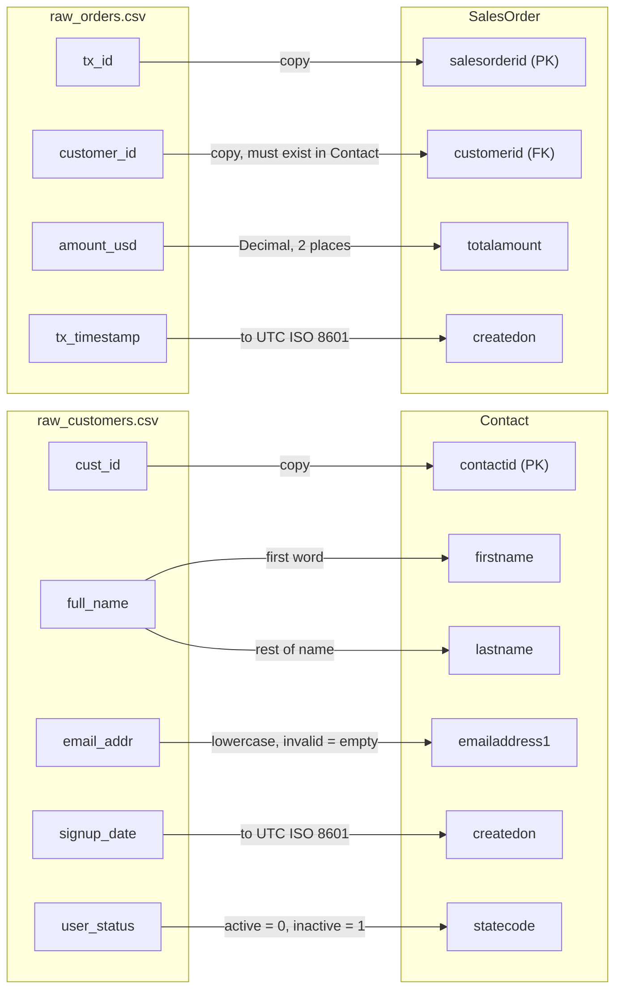
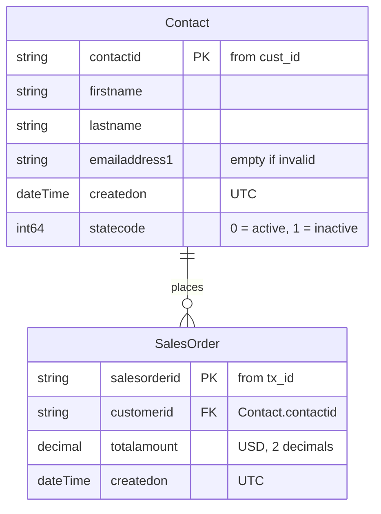
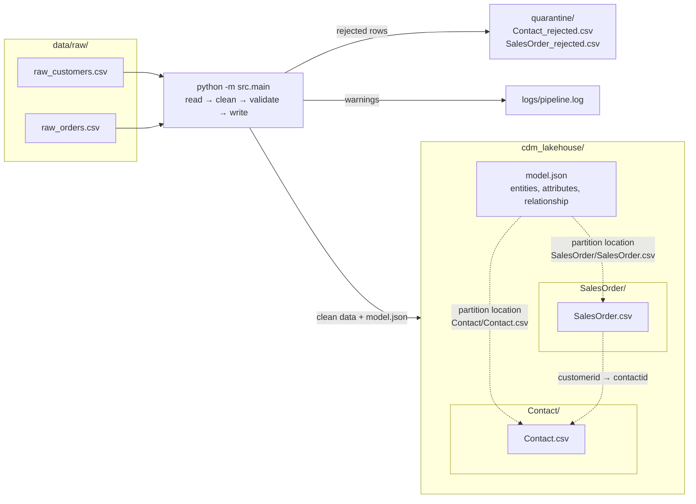

# CDM ingestion pipeline

A small Python pipeline that reads two raw CSV files, cleans them, maps them to the Microsoft
Common Data Model (CDM) entities **Contact** and **SalesOrder**, and writes the result together
with a `model.json` manifest.

## Deliverables

| Requirement | Location |
|---|---|
| Modular Python ETL and manifest generation | [`src/`](src/) |
| Raw input files supplied with the task | [`data/raw/`](data/raw/) |
| Generated Contact and SalesOrder data | [`cdm_lakehouse/`](cdm_lakehouse/) |
| Warnings produced from the supplied data | [`logs/pipeline-warnings.log`](logs/pipeline-warnings.log) |
| CDM metadata manifest | [`cdm_lakehouse/model.json`](cdm_lakehouse/model.json) |
| Source-to-target, entity relationship and storage diagrams | [Step 4: Diagrams](#step-4-diagrams) |
| Automated tests | [`tests/`](tests/) |
| Five-slide implementation walkthrough | [`docs/CDM-pipeline-5-slide-walkthrough.pptx`](docs/CDM-pipeline-5-slide-walkthrough.pptx) · [PDF](docs/CDM-pipeline-5-slide-walkthrough.pdf) |

The committed CSV files and `model.json` are the output of `python -m src.main`. CI reruns the
pipeline and fails if those deliverables are out of date.

## How to run

You need Python 3.11 or newer. Open a terminal in this folder, then:

1. Create and activate a virtual environment:

   ```bash
   python -m venv .venv
   .venv\Scripts\activate          # Windows
   source .venv/bin/activate       # Linux / macOS
   ```

2. Install the dependencies:

   ```bash
   pip install -r requirements.txt
   ```

3. Run the pipeline:

   ```bash
   python -m src.main
   ```

You should see this. Each line starts with the time of the run in UTC:

```
2026-10-22T16:06:46Z WARNING raw_customers.csv line 7: record was split over two lines, joined it
2026-10-22T16:06:46Z WARNING customer CST-003: invalid email 'invalid-email-format', set to empty
2026-10-22T16:06:46Z WARNING record ORD-1005 rejected: orphan order: customer CST-999 not found in Contact
2026-10-22T16:06:46Z INFO    Contact: 5 read, 5 written, 0 quarantined
2026-10-22T16:06:46Z INFO    SalesOrder: 5 read, 4 written, 1 quarantined
```

The run writes these files:

| File | What it holds |
|---|---|
| `cdm_lakehouse/Contact/Contact.csv` | The clean contacts |
| `cdm_lakehouse/SalesOrder/SalesOrder.csv` | The clean sales orders |
| `cdm_lakehouse/model.json` | The CDM manifest |
| `quarantine/Contact_rejected.csv`, `quarantine/SalesOrder_rejected.csv` | Rows that could not be loaded, with the reason |
| `logs/pipeline.log` | The complete log of the last run (generated locally) |
| `logs/pipeline-warnings.log` | The warnings from the supplied data; regenerated and committed as a submission output |

Every run rebuilds these files from `data/raw/`, so the same input always gives the same output.
The committed warning log records the repaired customer row, invalid email and orphan order. It
omits run timestamps so a fresh run produces the same committed file.

### Checks (optional)

To run the same checks as the CI:

```bash
pip install -r requirements-dev.txt
ruff check .                     # lint
ruff format --check .            # code format
mypy src                         # types
pip-audit -r requirements.txt    # known vulnerabilities in the dependencies
pytest --cov=src --cov-report=term-missing --cov-fail-under=95    # tests, at least 95% coverage
```

ruff and mypy are pinned in `requirements-dev.txt`, so the checks give the same result locally
and in CI. To run ruff on every commit, run `pre-commit install` once (set up in
`.pre-commit-config.yaml`).

The GitHub Actions workflow (`.github/workflows/ci.yml`) runs on every push and pull request, on
Python 3.11 and 3.13. It runs when this folder is the root of the repository. The steps:

1. The five checks above. The run fails if one of them fails, or if coverage is below 95%.
2. The pipeline itself.
3. A check that the committed `cdm_lakehouse/` files still match what the code produces.
4. The log and the quarantine files are kept as a download on the run's page (artifact
   `pipeline-output-py<version>`).

## How it works

1. **Read** the two raw CSV files.
2. **Clean and check** every row and turn it into a Contact or a SalesOrder. A row that cannot be
   loaded goes to `quarantine/` with the reason, and is logged.
3. **Write** the clean rows to `cdm_lakehouse/`, one folder per entity.
4. **Write** `model.json`, which describes both entities and points to their files.

```
cdm-pipeline/
├── data/raw/              input: raw_customers.csv, raw_orders.csv (as given in the task)
├── src/
│   ├── main.py            runs the four steps above
│   ├── etl.py             reads the CSVs, turns rows into Contact / SalesOrder, writes the CSVs
│   ├── cleaning.py        the cleaning rules: timestamps, email, name, status
│   ├── models.py          the two CDM entities: columns, types and CDM data types
│   └── manifest.py        builds model.json from the two entities
├── cdm_lakehouse/         output
├── tests/                 pytest tests
├── requirements.txt       what the pipeline needs
├── requirements-dev.txt   plus what the checks need
└── ruff.toml              lint and format rules
```

## Step 1: Mapping

**raw_customers.csv → Contact**

| Source field | CDM field | Type | Rule |
|---|---|---|---|
| `cust_id` | `contactid` | string | Copied. Primary key. |
| `full_name` | `firstname` | string | First word of the name. |
| `full_name` | `lastname` | string | The rest of the name. |
| `email_addr` | `emailaddress1` | string | Trimmed and lowercased. An invalid email is logged and left empty. |
| `signup_date` | `createdon` | dateTime | Converted to UTC, written as `YYYY-MM-DDTHH:MM:SSZ`. |
| `user_status` | `statecode` | int64 | `active` → 0, `inactive` → 1, in any letter case. |

**raw_orders.csv → SalesOrder**

| Source field | CDM field | Type | Rule |
|---|---|---|---|
| `tx_id` | `salesorderid` | string | Copied. Primary key. |
| `customer_id` | `customerid` | string | Copied. Foreign key: must exist in `Contact.contactid`, otherwise the order is logged and quarantined. |
| `amount_usd` | `totalamount` | decimal | Read as a decimal number, written with 2 decimals. |
| `tx_timestamp` | `createdon` | dateTime | Converted to UTC, written as `YYYY-MM-DDTHH:MM:SSZ`. |

### Problems in the mock data

| Problem | What the pipeline does |
|---|---|
| Three timestamp formats: `2023-01-15T10:30:00Z`, `2023-02-20 14:15:00`, `2023-03-05` | All are written in UTC as `YYYY-MM-DDTHH:MM:SSZ`. |
| Uppercase email (`JOHN.SMITH@DOMAIN.COM`) | Lowercased. |
| Invalid email (`invalid-email-format`) | Logged with the customer ID and written as empty. The contact is kept. |
| `ACTIVE` in capitals | The status is matched in any letter case. |
| CST-005 is on two lines, with spaces around the name | The task PDF most likely just wrapped this long line (it wraps the long lines of the model.json reference the same way), but the data is copied exactly as shown. The reader joins a record that is cut in two and logs it; a record on one line is read normally. The name is trimmed, and the output is the same either way. |
| Order ORD-1005 belongs to CST-999, which does not exist | Not written to `SalesOrder.csv`. It goes to `quarantine/SalesOrder_rejected.csv` with the reason, and is logged. |

### Assumptions

- **Time zone.** Timestamps without a time zone are taken as UTC. The task does not say which time
  zone the source uses, but every timestamp that has one ends in `Z` (UTC). So
  `2023-02-20 14:15:00` becomes `2023-02-20T14:15:00Z`, and `2023-03-05` becomes
  `2023-03-05T00:00:00Z`. If the source uses local time, only `SOURCE_TZ` in `src/cleaning.py`
  has to change.
- **Names.** Extra spaces are removed. The first word is the first name and the rest is the last
  name, so `Vincent van Gogh` gives `Vincent` / `van Gogh`. A single word gives an empty last name.
- **Email check.** A simple format check: `something@something.something`, no spaces. It catches
  broken values; it cannot tell whether the mailbox exists.
- **Unknown status.** Only `active` and `inactive` are known. Any other value sends the row to
  quarantine instead of guessing a code.
- **Amounts** are read as `Decimal`, not float, so there are no rounding errors. A value that is
  not a number (for example `12,50`) or has more than 2 decimals sends the row to quarantine.
- **Rejected rows.** A row goes to quarantine if a required value is missing or cannot be read,
  the status is unknown, or the order's customer does not exist. The quarantine file keeps the raw
  values plus a `reason` column.
- **Broken lines** that cannot be repaired (too many fields, or the file ends in the middle of a
  record) are logged and skipped.

## Step 2: Storage

```
cdm_lakehouse/
├── model.json
├── Contact/
│   └── Contact.csv
└── SalesOrder/
    └── SalesOrder.csv
```

Each CSV has a header row and uses a comma as the delimiter. Empty values are written as empty
fields, because CSV has no `null`.

## Step 3: model.json

`src/manifest.py` builds `model.json` from the two entities in `src/models.py`. The CSV columns
come from the same place, so the files and the manifest always match. It contains:

- the manifest's `name`, `description` and `version`;
- the entities `Contact` and `SalesOrder`, each with its attributes (`name`, `dataType`,
  `description`);
- one partition per entity, pointing to its CSV file;
- the relationship from `SalesOrder.customerid` to `Contact.contactid`.

Two tests check it (`tests/test_manifest.py`): it is identical to the "Expected model.json
Structure Reference" in the task, and it is valid against Microsoft's official
[model.json schema](https://github.com/microsoft/CDM/blob/master/docs/schema/modeljsonschema.json)
(copied to `tests/modeljsonschema.json`, © Microsoft, licensed CC BY 4.0).

The partition `location` is relative (`Contact/Contact.csv`), as in the task. In real storage,
for example Azure Data Lake, it would be the file's full URL.

## Step 4: Diagrams

### Source-to-target mapping



### Entity relationship

One contact has zero or more sales orders, and every sales order belongs to exactly one contact
(1:N). `SalesOrder.customerid` is the foreign key to `Contact.contactid`. There is no 1:1
relationship in this model.



### Storage layout

The pipeline writes one CSV per entity in its own folder, and `model.json` next to them.
`model.json` points to each CSV through the partition `location`, so a tool that reads the
lakehouse starts from `model.json`.



## What I would add next

- A check for duplicate IDs (the mock data has none).
- Incremental loads: today every run rewrites the full files.
- Running on a schedule or when a new file arrives, instead of by hand.
- Real storage (for example Azure Data Lake) with full partition URLs, and Parquet instead of CSV
  for larger data.

---

Tahasanul Ibrahim
